<picture>
  <source media="(prefers-color-scheme: dark)" srcset="assets/banner-dark.svg">
  
</picture>

  
  
  

  

---

### About

I work where AI, product and business meet: scoping a problem with stakeholders, building the solution, and explaining the results to the people who decide.

- **Product Management Intern at OneMetric** (May - Jul 2026): built an OCR and image-recognition eKYC tool that cut onboarding delays by 70%, and owned an AI/ML intent analyzer for B2B sales that cut lead qualification time by 60%. Two solutions reached production.
- **Currently building** AI agents and automating workflows end to end, from requirements to deployed tools. Latest: [PolicyPilot](https://github.com/SanchitSlayer/policypilot), a compliance copilot with cited RAG answers and a tool-calling review agent.
- **Leadership:** Overall Coordinator of the Placement Cell at IIT Jodhpur, and former Overall Coordinator of The Product Club.

---

### Featured projects

<table>
<tr>
<td valign="top">

#### [PolicyPilot](https://github.com/SanchitSlayer/policypilot) &nbsp; Flagship AI project
An AI compliance copilot for compliance, operations and legal teams. It answers questions from policy PDFs **only from the uploaded text, with page-level citations**, and says so when the documents don't cover a question. A **tool-calling contract review agent** checks a contract clause by clause against those policies and produces an auditable checklist, with guardrails that reject citations to passages it never retrieved. Switch between OpenAI, Claude and Gemini per request; every LLM call is logged for tokens, latency and cost on an admin dashboard. Ships with a 47-question retrieval evaluation and CI for backend and frontend.

`RAG` `AI Agents` `Tool Calling` `FastAPI` `PostgreSQL + pgvector` `MongoDB` `Next.js 15` `Docker`

</td>
</tr>
</table>

<table>
<tr>
<td width="50%" valign="top">

#### [Digital Wallet & eKYC](https://github.com/SanchitSlayer/digital-wallet-ekyc)
Full-stack digital wallet with OCR-based identity verification, atomic wallet-to-wallet transfers, a SHA-256 hash-chained ledger that makes tampering detectable, and HMAC-signed QR payments. Includes architecture, data model and OWASP-based security review docs, plus a pytest suite.

`FastAPI` `PostgreSQL` `React` `TypeScript` `Tesseract OCR` `JWT`

</td>
<td width="50%" valign="top">

#### [Walkins](https://github.com/SanchitSlayer/walkins)
Walk-in interview platform that alerts nearby candidates about hiring drives in time. Geospatial targeting based on each candidate's own travel radius, queued notifications over Telegram, and a FastAPI ML sidecar for speech-to-text and multilingual embeddings.

`Next.js` `NestJS` `PostGIS` `BullMQ` `FastAPI` `Docker`

</td>
</tr>
<tr>
<td width="50%" valign="top">

#### [Delivery System Database](https://github.com/SanchitSlayer/delivery-system-database)
Normalized (3NF) SQL Server database of 8 tables for a food and grocery delivery platform, loaded with about 164,000 realistic rows from a Python generator. 20 analysis queries using joins, CTEs and window functions, 9 views, 4 stored procedures, and indexes benchmarked at 45-99% fewer logical reads. One command builds it all and exports 6 KPIs for a Power BI dashboard.

`SQL Server` `T-SQL` `Python` `Docker` `Power BI`

</td>
<td width="50%" valign="top">

#### Cryptocurrency Market Sentiment Analysis
Asynchronous data pipeline over the Reddit API combined with 10,000+ tweets. VADER sentiment scoring classifies posts into 3 classes, and daily sentiment is correlated with Bitcoin returns.

`Python` `Asyncio` `REST APIs` `NLTK`

</td>
</tr>
</table>

---

### Skills

**Languages** 

**AI/ML and Analytics** 

**Backend and Data** 

**Security and FinTech** 

**Product and Consulting** 

**Tools** 

---

### Experience

**Product Management Intern, OneMetric** &nbsp;|&nbsp; Gurgaon &nbsp;|&nbsp; May 2026 - Jul 2026
- Built an eKYC identity-verification tool with OCR and image recognition, cutting onboarding delays by 70%.
- Owned an AI/ML intent analyzer for B2B sales from scoping to deployment, cutting lead qualification time by 60%.
- Translated stakeholder requirements into user flows and ranked features by value versus effort.
- Validated proofs of concept with users and presented analytics and model explanations to leadership; 2 solutions reached production.

### Leadership and achievements

- Overall Coordinator, Placement Cell, IIT Jodhpur (present)
- Overall Coordinator, The Product Club, IIT Jodhpur (Aug 2025 - Apr 2026)
- Assistant Head, E-Cell, Institute Innovation Council (Jul 2024 - May 2025)
- 3rd place, Product Club's Pitch Rush 2025, with a product deck on BluSmart

---

### GitHub activity

<picture>
  <source media="(prefers-color-scheme: dark)" srcset="https://raw.githubusercontent.com/SanchitSlayer/SanchitSlayer/output/stats-dark.svg">
  
</picture>

<picture>
  <source media="(prefers-color-scheme: dark)" srcset="https://raw.githubusercontent.com/SanchitSlayer/SanchitSlayer/output/snake-dark.svg">
  
</picture>
